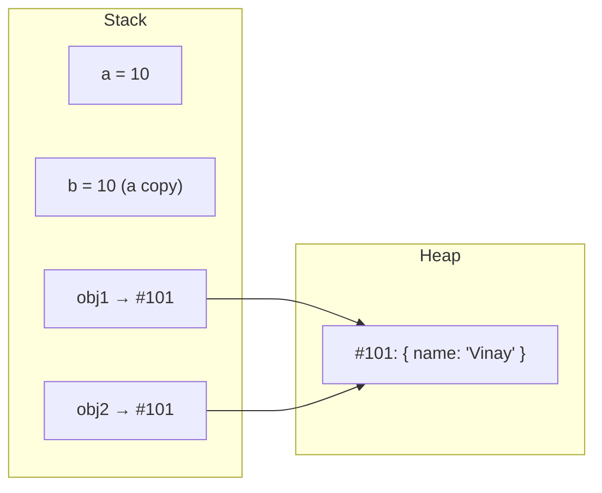
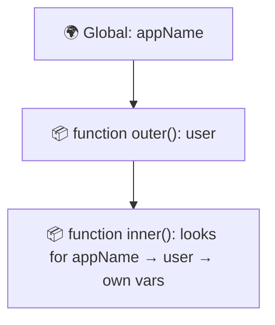
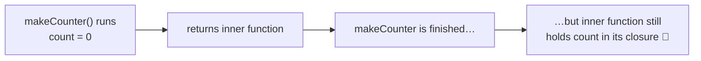
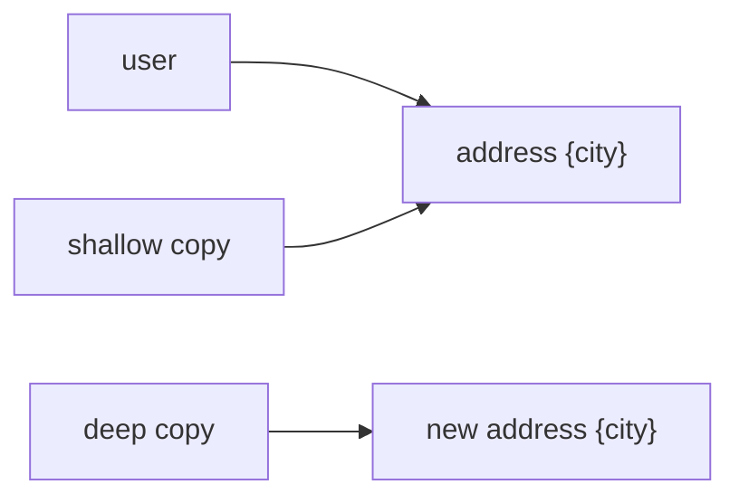
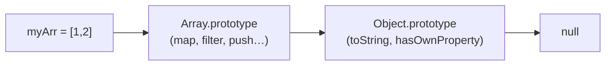
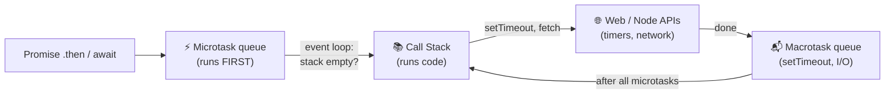
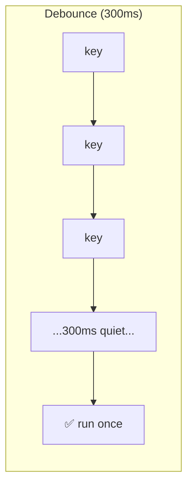
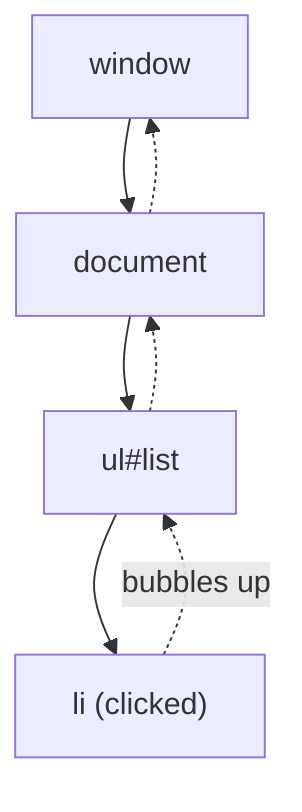

# 1 · JavaScript

Every full-stack interview starts here. Strong JavaScript makes **TypeScript, React and Node** answers easy, because TypeScript is just JavaScript with types on top.

:::note
**How to read each card (2 minutes per question):**
1. **⚡ Quick answer:** read it, then close your eyes and say it. This is your 10-second answer.
2. **📖 Explanation:** read it once to understand *why*.
3. **🎤 Interview answer:** say the points out loud, in your own words, in order.
4. **🔷 TypeScript angle:** for the TypeScript interview (Kochi role). Read it after the JavaScript part.
:::

## Basics

### What is the difference between var, let and const? {basic}

:::quick
**`var` is function-scoped; `let` and `const` are block-scoped. `const` can't be reassigned.**
**Why it matters:** `var` leaks out of `if` blocks and loops and causes bugs. `const` by default makes code predictable.
:::

**📖 Explanation**

All three create variables. They differ in **scope** (where the variable is visible) and in **whether it can be reassigned**.

| | `var` | `let` | `const` |
|---|---|---|---|
| Scope | Function | Block `{ }` | Block `{ }` |
| Reassign | ✅ | ✅ | ❌ |
| Redeclare | ✅ | ❌ | ❌ |
| Hoisted | Yes, as `undefined` | Yes, but in the TDZ | Yes, but in the TDZ |

```js
if (true) { var a = 1; let b = 2; }
console.log(a); // 1  (var leaks out of the block)
console.log(b); // ReferenceError

const user = { name: "Vinay" };
user.name = "V";   // ✅ allowed: the object can change
user = {};         // ❌ TypeError: the binding can't
```

:::say
- `var` is **function-scoped**, so it leaks out of `if` blocks and loops.
- `let` and `const` are **block-scoped**: they live only inside `{ }`.
- `const` stops **reassignment**, but an object inside a `const` can still be changed.
- In my code I use `const` by default, `let` only when the value really changes, and never `var`.
:::

:::warn
Saying "`const` makes an object immutable." It doesn't. Use `Object.freeze()` for that, or `readonly` / `as const` in TypeScript.
:::

:::ts
TypeScript infers a **narrower type** from `const`: `const role = "admin"` has the type `"admin"`, while `let role = "admin"` has the type `string`. `as const` makes a whole object or array read-only with literal types.
:::

### What are the data types in JavaScript? Primitive vs reference? {basic}

:::quick
**7 primitives (string, number, bigint, boolean, undefined, null, symbol) are copied by value. Objects, arrays and functions are copied by reference.**
**Why it matters:** two variables can point to the same object, which is why React state must never be mutated.
:::

**📖 Explanation**

- **Primitives** hold the actual value. Copying gives an independent copy.
- **Reference types** hold an **address** to an object in memory. Copying the variable copies the address, so both variables share one object.



```js
let a = 10; let b = a; b = 20;   // a is still 10
const obj1 = { name: "Vinay" };
const obj2 = obj1; obj2.name = "V"; // obj1.name is "V" too: same object
```

:::say
- JavaScript has **7 primitive types**: string, number, bigint, boolean, undefined, null and symbol. They're **copied by value**.
- Everything else is an **object**, copied **by reference**, so two variables can share one object.
- That's why in React I **never mutate state**: I create a new object or array, so React sees a new reference and re-renders.
:::

:::tip
- "What does `typeof null` return?" → `"object"`. It's a historic bug in the language.
- "How do you check for an array?" → `Array.isArray(x)`.
:::

:::ts
TypeScript adds its own types on top: `any` (switches checking off), `unknown` (safe "could be anything"), `never` (can't happen), `void` (returns nothing), plus tuples, enums and literal types. The JavaScript runtime types stay the same.
:::

### What is the difference between == and ===? {basic}

:::quick
**`===` checks value and type. `==` converts types first (coercion).**
**Why it matters:** `0 == "0"` is `true`, which hides bugs. Always use `===`.
:::

**📖 Explanation**

`==` converts both sides to the same type before comparing (**type coercion**). `===` compares value **and** type, with no conversion.

```js
0 == "0"          // true   (string converted to number)
0 === "0"         // false
null == undefined // true
null === undefined// false
[] == false       // true   😬 (coercion surprises)
```

:::say
- `===` is **strict equality**: value and type must both match.
- `==` **converts types** first, which gives surprises like `0 == "0"` being true.
- I always use `===`, and **ESLint** enforces it in my projects.
- The one place `==` is acceptable: `x == null` checks for both `null` and `undefined`.
:::

:::ts
TypeScript catches many of these at compile time: comparing a `number` with a `string` gives the error "This comparison appears to be unintentional because the types have no overlap".
:::

### What is the difference between null and undefined? {basic}

:::quick
**`undefined` = no value assigned yet (JavaScript sets it). `null` = empty on purpose (you set it).**
**Why it matters:** APIs and databases return both, so you need to handle both, usually with `??`.
:::

**📖 Explanation**

- `undefined`: a variable was declared but **no value was assigned**, or a property or argument is missing.
- `null`: **intentionally empty**, set by the developer.

```js
let x;           // undefined
let user = null; // "no user yet", on purpose
```

:::say
- `undefined` means **no value has been assigned**; JavaScript gives it automatically, for example to a missing argument or property.
- `null` is an **intentional "empty"** that I assign myself.
- To handle both, I use `??` or `?.`.
- In PostgreSQL, an empty column comes back as `null`, so my API code handles `null` explicitly.
:::

:::ts
With `strictNullChecks` on (part of `"strict": true`), a variable of type `string` **can't** be `null` or `undefined`. You must write `string | null`, and TypeScript forces you to check before using it. This removes most "cannot read property of undefined" crashes.
:::

### What is hoisting? What is the Temporal Dead Zone (TDZ)? {basic}

:::quick
**Hoisting = declarations are processed before the code runs. `let`/`const` exist but can't be used before their line (the TDZ).**
**Why it matters:** explains why `var` gives `undefined` but `let` throws an error.
:::

**📖 Explanation**

Before running a scope, JavaScript registers its **declarations** (only the declaration, not the value).

```js
console.log(a); // undefined  (var is hoisted with undefined)
var a = 5;

console.log(b); // ReferenceError: in the TDZ
let b = 5;

greet();        // works: function declarations are fully hoisted
function greet() { console.log("hi"); }
```

**TDZ (Temporal Dead Zone):** the time between entering a scope and reaching the `let`/`const` line. Using the variable in that time throws an error.

:::say
- Hoisting means **declarations are processed before code runs**.
- `var` is hoisted and set to **`undefined`**.
- **Function declarations** are hoisted completely, so you can call them before they appear.
- `let` and `const` are hoisted but stay in the **Temporal Dead Zone** until their line, so early use throws a ReferenceError.
- That's safer: the bug shows up immediately instead of silently giving `undefined`.
:::

### What is scope and lexical scope? What is the scope chain? {basic}

:::quick
**Scope = where a variable is visible. Lexical scope = a function sees variables from where it was *written*.**
**Why it matters:** it's the foundation of closures, and closures power React hooks and debounce.
:::

**📖 Explanation**

- **Scope** types: **global**, **function** and **block**.
- **Lexical scope:** a function can use variables from where it was **written**, not where it's called.
- **Scope chain:** if a variable isn't found locally, JavaScript looks in the parent scope, then its parent, up to global.



:::say
- Scope decides **where a variable is visible**: global, function or block.
- JavaScript uses **lexical scoping**: a function sees variables from where it's **defined**.
- If a variable isn't found locally, JavaScript walks up the **scope chain** to the outer scopes.
- This is exactly what makes **closures** possible.
:::

## Functions

### What is a closure? {mid}

:::quick
**A closure is a function that remembers the variables from where it was created, even after that outer function has finished.**
**Why it matters:** private data, debounce, memoization and React hooks all depend on closures.
:::

**📖 Explanation**

**Analogy:** a backpack. When an inner function is created, it packs the outer variables into a backpack and carries them wherever it goes.

```js
function makeCounter() {
  let count = 0;              // private variable
  return function () {
    count++;
    return count;
  };
}
const counter = makeCounter();
counter(); // 1
counter(); // 2   (count is remembered)
```



**Real uses:** private variables, debounce and throttle, memoization, React hooks (`useState` relies on closures), event handlers.

:::say
- A closure is a function that **remembers the variables of the scope where it was created**.
- It keeps them **even after the outer function has returned**.
- Example: a counter function keeps its `count` **private**; nobody outside can change it.
- I use closures daily: the timer ID in a **debounce** function, and every **React event handler** closes over the current props and state.
:::

:::proj
In React, a **stale closure** is a common bug: a `setInterval` inside `useEffect` keeps reading old state. The fix is the functional update `setCount(c => c + 1)` or the correct dependency list.
:::

:::tip
- "What's a stale closure?" → a function captured an old value (common in `useEffect` and intervals).
- "Can closures cause memory leaks?" → yes, if they hold large objects and are never released (for example, listeners never removed).
:::

### How does the this keyword work? {mid}

:::quick
**`this` depends on *how* a function is called. Arrow functions don't have their own `this`; they take it from the surrounding code.**
**Why it matters:** lost `this` in callbacks is a classic bug and a favourite output question.
:::

**📖 Explanation**

| How it's called | `this` is |
|---|---|
| `obj.method()` | `obj` |
| plain `fn()` | `undefined` in strict mode (or `window`) |
| `new Fn()` | the new object |
| `fn.call(x)` / `apply` / `bind` | `x` |
| arrow function | `this` from the surrounding scope (lexical) |
| DOM event handler | the element |

```js
const user = {
  name: "Vinay",
  regular() { return this.name; },      // "Vinay"
  arrow: () => this?.name,              // undefined: arrow has no own `this`
  delayed() { setTimeout(() => console.log(this.name), 100); } // "Vinay"
};
```

:::say
- `this` is decided **at call time**, not where the function is written.
- Called as `obj.method()`, `this` is **the object**. With `new`, it's **the new instance**.
- With `call`, `apply` or `bind`, it's **whatever I pass in**.
- **Arrow functions** have no own `this`; they take it from the surrounding code.
- That's why arrow functions are perfect for **callbacks inside methods**, like `setTimeout`.
:::

:::ts
TypeScript's `noImplicitThis` option (part of `strict`) gives an error when `this` would be `any`, and you can declare it: `function handler(this: HTMLButtonElement) { … }`.
:::

### What is the difference between call, apply and bind? {mid}

:::quick
**All three set `this`. `call` and `apply` run the function now (`apply` takes an array); `bind` returns a new function for later.**
**Why it matters:** fixes lost `this` in callbacks and event handlers.
:::

**📖 Explanation**

| | Runs now? | Arguments |
|---|---|---|
| `call` | ✅ | one by one: `fn.call(obj, a, b)` |
| `apply` | ✅ | as an array: `fn.apply(obj, [a, b])` |
| `bind` | ❌ returns a new function | `const f = fn.bind(obj, a)` |

```js
function greet(greeting) { return `${greeting}, ${this.name}`; }
const me = { name: "Vinay" };
greet.call(me, "Hi");        // "Hi, Vinay"
greet.apply(me, ["Hello"]);  // "Hello, Vinay"
const later = greet.bind(me); later("Hey"); // "Hey, Vinay"
```

:::say
- All three **set `this` explicitly**.
- `call` runs the function **now**, with arguments **one by one**.
- `apply` runs it **now**, with arguments **as an array**.
- `bind` **doesn't run it**; it returns a **new function** with `this` fixed, useful for callbacks.
- Memory trick: **A**pply = **A**rray, **C**all = **C**omma.
:::

### Arrow functions vs regular functions? {basic}

:::quick
**Arrow functions are shorter and have no own `this` or `arguments`, and can't be used with `new`.**
**Why it matters:** choose arrows for callbacks, regular functions for methods that need their own `this`.
:::

**📖 Explanation**

| | Regular | Arrow |
|---|---|---|
| Own `this` | ✅ (depends on call) | ❌ (lexical) |
| `arguments` object | ✅ | ❌ (use `...args`) |
| Can be used with `new` | ✅ | ❌ |
| Short syntax / implicit return | ❌ | ✅ |
| Hoisted | ✅ (declarations) | ❌ |

:::say
- Arrow functions are **shorter** and support **implicit return**.
- They have **no own `this` or `arguments`**; `this` comes from the surrounding scope.
- They **can't be constructors** (no `new`).
- I use arrows for **callbacks, array methods and React components**, and regular functions for **object methods** that need their own `this`.
:::

### What are higher-order functions and callbacks? {basic}

:::quick
**A callback is a function passed into another function. A higher-order function takes or returns a function.**
**Why it matters:** `map`, `filter`, Express middleware and React hooks are all built on this.
:::

**📖 Explanation**

- **Callback:** a function passed into another function, to be called later.
- **Higher-order function:** a function that **takes** a function or **returns** one.

`map`, `filter`, `reduce`, `setTimeout` and Express's `app.get(path, handler)` are all higher-order functions.

:::say
- A **higher-order function** takes a function as input or returns one, like `map`, `filter` and `reduce`.
- The function passed in is called a **callback**.
- Express is a good example: `app.use` takes my middleware function and **calls it for each request**.
:::

:::ts
Typing a callback: `function retry(fn: () => Promise<Response>, times: number)`. TypeScript then checks that every callback passed in has the right shape.
:::

### What is currying? {mid}

:::quick
**Currying turns `f(a, b)` into `f(a)(b)`: each call takes one argument and returns the next function.**
**Why it matters:** it creates pre-configured functions, like `requireRole("admin")` middleware.
:::

**📖 Explanation**

```js
const add = (a) => (b) => a + b;
const add10 = add(10);
add10(5); // 15

// Practical: a reusable logger
const log = (level) => (msg) => console.log(`[${level}] ${msg}`);
const error = log("ERROR"); error("DB down");
```

:::say
- Currying turns a function with many arguments into a **chain of functions with one argument each**.
- It's useful for **pre-configured functions**: I fix the first argument now and pass the rest later.
- Real example: an Express middleware factory, `requireRole("admin")`, which **returns** a middleware.
:::

:::proj
Role-based access in VTMS is a natural example: `requireRole("admin")` returns `(req, res, next) => …`. That's currying used in a real backend.
:::

## Objects & arrays

### What is the difference between shallow copy and deep copy? {mid}

:::quick
**A shallow copy copies only the top level (nested objects are still shared). A deep copy copies everything.**
**Why it matters:** updating nested React state with a shallow copy can silently change the original.
:::

**📖 Explanation**

```js
const user = { name: "V", address: { city: "Hyd" } };

const shallow = { ...user };
shallow.address.city = "Vizag";   // ⚠️ user.address.city also changes

const deep = structuredClone(user);
deep.address.city = "Chennai";    // ✅ user is untouched
```



| Method | Type |
|---|---|
| `{...obj}`, `Object.assign`, `[...arr]` | Shallow |
| `structuredClone(obj)` | Deep (modern; handles dates and maps) |
| `JSON.parse(JSON.stringify(obj))` | Deep, but loses functions, dates and `undefined` |

:::say
- A **shallow copy**, like the spread operator, copies only the **first level**; nested objects are still **shared**.
- A **deep copy** duplicates **every level**.
- For deep copies I use **`structuredClone`**.
- In React, I update nested state by **spreading each level I change**; Redux Toolkit does this for me with Immer.
:::

### Explain map, filter, reduce and forEach. {basic}

:::quick
**`map` transforms, `filter` selects, `reduce` combines into one value, `forEach` only runs side effects (returns nothing).**
**Why it matters:** they don't mutate the original array, which suits React.
:::

**📖 Explanation**

| Method | Returns | Use it to |
|---|---|---|
| `map` | new array, same length | transform each item |
| `filter` | new array, fewer items | keep items that pass a test |
| `reduce` | a single value | sum, group or build an object |
| `forEach` | `undefined` | run side effects only |

```js
const tasks = [{ done: true, mins: 30 }, { done: false, mins: 15 }, { done: true, mins: 45 }];
const doneMins = tasks
  .filter(t => t.done)            // keep completed
  .map(t => t.mins)               // [30, 45]
  .reduce((sum, m) => sum + m, 0); // 75
```

:::say
- `map` **transforms** every item into a new array of the same length.
- `filter` **keeps** only the items that pass a condition.
- `reduce` **combines** everything into one value, like a total or a grouped object.
- `forEach` just **runs code** for each item and returns nothing.
- None of them change the original array, which is why I prefer them in **React rendering**.
:::

:::proj
TaskFlow's analytics (completion totals and category breakdown) is `filter` + `reduce` grouping. For large data, I move the same logic to the database (MongoDB aggregation or SQL `GROUP BY`).
:::

:::ts
TypeScript infers the result types: `tasks.map(t => t.mins)` is `number[]`. For `reduce`, give the starting value a type: `reduce<Record<string, Task[]>>((acc, t) => …, {})`.
:::

### What are destructuring, spread and rest? {basic}

:::quick
**Destructuring unpacks values, spread `...` expands them, rest `...` collects the remaining ones.**
**Why it matters:** used everywhere for props, immutable state updates and removing fields like `password`.
:::

**📖 Explanation**

```js
// Destructuring: unpack values
const { name, role = "dev" } = user;           // object (with default)
const [first, second] = [10, 20];              // array

// Spread: expand
const merged = { ...defaults, ...options };    // later keys win
const all = [...arr1, ...arr2];

// Rest: collect the remaining items
const { password, ...safeUser } = user;        // remove a field
function sum(...nums) { return nums.reduce((a, b) => a + b, 0); }
```

:::say
- **Destructuring** pulls values out of objects and arrays into variables, with **defaults** if needed.
- **Spread** expands them; I use it to **copy or merge immutably**.
- **Rest** collects the **remaining** values into a new object or array.
- Real example: `const { password, ...safeUser } = user` removes the password before sending the user to the client.
:::

:::ts
`Omit<User, "password">` describes `safeUser`'s type, so TypeScript guarantees the password can't be sent back by mistake.
:::

### What are prototypes and prototypal inheritance? {mid}

:::quick
**Every object links to a prototype object. If a property isn't found, JavaScript looks up the prototype chain.**
**Why it matters:** it's how arrays get `map` and how ES6 classes work underneath.
:::

**📖 Explanation**



```js
const animal = { speak() { return "..."; } };
const dog = Object.create(animal);
dog.speak(); // "..." found on the prototype
```

:::say
- JavaScript uses **prototypal inheritance**: every object has a link to a **prototype** object.
- If a property isn't on the object, JavaScript **walks up the prototype chain** until it finds it or reaches `null`.
- That's how every array gets `map` and `filter`: they live on **`Array.prototype`**.
- **ES6 classes** are just cleaner syntax over the same mechanism.
:::

### What are ES6 classes? {basic}

:::quick
**Cleaner syntax over prototypes: `constructor`, methods, `extends`, `super`, `static` and `#private` fields.**
**Why it matters:** common for custom error classes (`AppError`) and services in TypeScript backends.
:::

**📖 Explanation**

```js
class User {
  #password;                       // private field
  constructor(name, password) { this.name = name; this.#password = password; }
  greet() { return `Hi ${this.name}`; }
  static fromJSON(o) { return new User(o.name, o.password); }
}
class Admin extends User {
  greet() { return super.greet() + " (admin)"; }
}
```

:::say
- Classes are **syntactic sugar over prototypes**.
- They give a **constructor**, methods, **`extends`** for inheritance and **`super`** to call the parent.
- **`static`** methods belong to the class itself; **`#private`** fields are hidden from outside.
- In backends I use them for **custom errors**, like an `AppError` with a status code.
:::

:::ts
TypeScript adds `public`, `private`, `protected` and `readonly`, plus `implements` for interfaces:

```ts
class AppError extends Error {
  constructor(public statusCode: number, message: string) { super(message); }
}
```

Note: TypeScript's `private` is checked only at compile time; JavaScript's `#private` is enforced at runtime.
:::

### What are optional chaining (?.) and nullish coalescing (??)? {basic}

:::quick
**`?.` reads nested properties safely (returns `undefined` instead of crashing). `??` gives a default only for `null`/`undefined`.**
**Why it matters:** `||` wrongly replaces `0` and `""`; `??` keeps them.
:::

**📖 Explanation**

```js
const city = user?.address?.city;          // undefined instead of crashing
const limit = req.query.limit ?? 20;       // only null/undefined use the default
const count = 0 || 10;   // 10  (|| treats 0 as falsy ❌)
const count2 = 0 ?? 10;  // 0   (?? keeps 0 ✅)
```

:::say
- **Optional chaining `?.`** safely reads nested properties: if something in the middle is missing, it returns `undefined` instead of throwing.
- **Nullish coalescing `??`** gives a default **only for `null` or `undefined`**.
- `||` also replaces `0` and empty strings, which is wrong for values like a **page number or a count**.
:::

### Map and Set vs object and array? {mid}

:::quick
**`Map` is a key-value store with any key type and a fast `.size`. `Set` stores unique values.**
**Why it matters:** removing duplicates and fast lookups come up in coding rounds.
:::

**📖 Explanation**

| | Object | Map |
|---|---|---|
| Key types | strings and symbols | **any** (objects, numbers…) |
| Size | `Object.keys(o).length` | `map.size` |
| Order | mostly insertion | insertion, guaranteed |
| Frequent add/delete | slower | optimised |

```js
const unique = [...new Set([1, 2, 2, 3])];   // [1, 2, 3]
const seen = new Set(); seen.has(id);        // O(1) lookup instead of array.includes O(n)
const cache = new Map(); cache.set(userObj, data);
```

:::say
- A **Map** is a key-value store where **keys can be any type**, with a built-in `size` and guaranteed order.
- A **Set** stores **unique values**, so `[...new Set(arr)]` removes duplicates.
- `set.has()` is **O(1)**, much faster than `array.includes()` on big lists.
- I use plain objects for **fixed-shape data** (like JSON) and Map/Set for **lookups and caches**.
:::

### What are pure functions and immutability? {basic}

:::quick
**A pure function returns the same output for the same input and changes nothing outside itself. Immutability = create new data instead of changing the old.**
**Why it matters:** React and Redux depend on it to detect changes; pure functions are easy to test.
:::

**📖 Explanation**

```js
// ❌ impure: changes the input
function addTask(list, task) { list.push(task); return list; }
// ✅ pure: returns a new array
const addTask = (list, task) => [...list, task];
```

:::say
- A **pure function** gives the **same output for the same input** and has **no side effects**.
- **Immutability** means I create **new objects or arrays** instead of changing the old ones.
- React compares **references** to decide whether to re-render, so mutating state means the UI doesn't update.
- Pure functions are also the **easiest to unit-test**, which is why I keep business logic pure and separate from Express handlers.
:::

## Async JavaScript

### Explain the event loop. {mid}

:::quick
**JavaScript runs one thing at a time on the call stack. Slow work goes to the browser/Node; its callback waits in a queue, and the event loop runs it when the stack is empty. Promises (microtasks) go before timers (macrotasks).**
**Why it matters:** explains how Node serves many requests on one thread, and every "predict the output" question.
:::

**📖 Explanation**

1. Code runs on the **call stack**, one line at a time.
2. Slow work (timers, network, file reads) is handed to **Web / Node APIs**.
3. When it finishes, its callback waits in a **queue**.
4. The **event loop** moves a callback onto the stack **only when the stack is empty**, and always empties the **microtask** queue first.



```js
console.log("1");
setTimeout(() => console.log("2"), 0);
Promise.resolve().then(() => console.log("3"));
console.log("4");
// Output: 1, 4, 3, 2
```

:::say
- JavaScript is **single-threaded**: one call stack, one thing at a time.
- **Async work**, like timers or API calls, is handed to the browser or Node.
- When it's done, the callback waits in a **queue**.
- The **event loop** pushes it onto the stack **only when the stack is empty**.
- **Promise callbacks (microtasks) always run before timers (macrotasks)**, so a resolved promise logs before a 0 ms `setTimeout`.
:::

:::proj
This is why Node handles many requests on one thread: while the server waits for PostgreSQL or MongoDB, the thread serves other requests. It's also why a heavy CPU loop in a route handler would block **every** user.
:::

### What is the difference between microtasks and macrotasks? {adv}

:::quick
**Microtasks = promise callbacks and `await` continuations. Macrotasks = `setTimeout`, I/O and events. All microtasks run before the next macrotask.**
**Why it matters:** this decides the order in async output questions.
:::

**📖 Explanation**

| Microtasks (higher priority) | Macrotasks |
|---|---|
| `Promise.then/catch/finally`, `await` continuation, `queueMicrotask`, `process.nextTick` (Node, even earlier) | `setTimeout`, `setInterval`, `setImmediate` (Node), I/O, UI events |

**Rule:** after each macrotask, the event loop runs **all** microtasks before taking the next macrotask.

```js
setTimeout(() => console.log("timeout"), 0);
Promise.resolve().then(() => {
  console.log("promise 1");
  Promise.resolve().then(() => console.log("promise 2"));
});
// promise 1 → promise 2 → timeout
```

:::say
- **Microtasks** are promise callbacks and `await` continuations.
- **Macrotasks** are timers, I/O and UI events.
- After each macrotask, the engine **empties the whole microtask queue** before moving on.
- So promises always run **before** the next `setTimeout`, even a 0 ms one.
- In Node, **`process.nextTick`** runs even before other microtasks.
:::

### Callbacks vs Promises vs async/await? {basic}

:::quick
**Callbacks nest into "callback hell". Promises chain with one `.catch`. `async/await` is built on promises and reads like normal code.**
**Why it matters:** every Express controller and React data fetch uses `async/await`.
:::

**📖 Explanation**

A **Promise** is an object for a future value, with 3 states: **pending → fulfilled** or **rejected**.

```js
// 1. Callbacks → "callback hell" (nesting, hard error handling)
getUser(id, (err, user) => { getTasks(user.id, (err, tasks) => { /* ... */ }); });

// 2. Promises → chainable, one .catch
getUser(id).then(u => getTasks(u.id)).then(show).catch(handle);

// 3. async/await → reads like normal code
async function load(id) {
  try { const u = await getUser(id); const t = await getTasks(u.id); show(t); }
  catch (e) { handle(e); }
}
```

:::say
- **Callbacks** were the original approach, but nesting them causes **callback hell** and messy error handling.
- A **Promise** represents a **future value** (pending, fulfilled or rejected) and chains with a single `.catch`.
- **`async/await`** is built on promises and makes async code **read top to bottom**, with `try/catch` for errors.
- I use `async/await` in all my **Express controllers**.
:::

:::ts
An `async` function always returns `Promise<T>`: `async function getUser(id: string): Promise<User>`. Forgetting `await` is caught by TypeScript, because a `Promise<User>` doesn't have a `.name` property.
:::

### Explain Promise.all, allSettled, race and any. {mid}

:::quick
**`all` = all must succeed (fails fast). `allSettled` = wait for all, success or fail. `race` = first to finish. `any` = first success.**
**Why it matters:** running independent requests in parallel makes dashboards load faster.
:::

**📖 Explanation**

| Method | Resolves when | Rejects when | Use for |
|---|---|---|---|
| `Promise.all` | **all** succeed | **any one** fails (fail fast) | Parallel requests that must all work |
| `Promise.allSettled` | all finish (success or fail) | never | Showing partial results |
| `Promise.race` | the **first** to settle | the first to fail | Timeouts |
| `Promise.any` | the **first success** | all fail | Fastest mirror or server |

```js
// Load dashboard data in parallel instead of one after another
const [user, tasks, stats] = await Promise.all([getUser(), getTasks(), getStats()]);
```

:::say
- **`Promise.all`** runs promises **in parallel** and **fails fast** if any one rejects.
- **`allSettled`** waits for **everything** and reports which succeeded, which is good when partial results are fine.
- **`race`** settles with **whichever finishes first**, which is useful for timeouts.
- **`any`** returns the **first successful** one.
- I use `Promise.all` to load **independent dashboard data at the same time**.
:::

:::proj
In a dashboard, loading the profile, upcoming classes and notifications with `Promise.all` instead of three sequential `await`s cuts the wait time to the slowest single call.
:::

### How do you handle errors in async/await? {basic}

:::quick
**Wrap `await` in `try/catch`. In Express, use an `asyncHandler` wrapper so errors reach one central error middleware.**
**Why it matters:** an unhandled rejection can crash a Node server.
:::

**📖 Explanation**

```js
// 1. try/catch
try { const data = await api(); } catch (err) { console.error(err.message); }

// 2. Express: wrap async handlers so errors reach the error middleware
const asyncHandler = (fn) => (req, res, next) => Promise.resolve(fn(req, res, next)).catch(next);
app.get("/tasks", asyncHandler(async (req, res) => { res.json(await Task.find()); }));
```

:::say
- With `async/await`, I wrap calls in **`try/catch`**.
- In Express, I use an **`asyncHandler` wrapper**, so any rejected promise goes to `next(err)`.
- One **central error middleware** then sends a **consistent error response**.
- That avoids repeating `try/catch` in every route, and unhandled rejections can't crash the server.
:::

:::warn
Forgetting `await` (you get a pending Promise instead of data), or an unhandled rejection crashing the Node process.
:::

:::ts
In a `catch` block, the error's type is **`unknown`** (with `strict`). Check it before use: `if (err instanceof Error) console.error(err.message)`.
:::

### How do you call an API with fetch, and cancel it? {mid}

:::quick
**`fetch` returns a promise; check `res.ok` yourself because it doesn't reject on 404/500. Cancel with `AbortController`.**
**Why it matters:** "fetch doesn't throw on 404" is a common trap, and cancelling avoids race conditions in React.
:::

**📖 Explanation**

```js
const controller = new AbortController();

async function loadTasks() {
  const res = await fetch("/api/tasks", { signal: controller.signal });
  if (!res.ok) throw new Error(`HTTP ${res.status}`);   // fetch doesn't throw on 4xx/5xx
  return res.json();
}

controller.abort();   // e.g. in a React useEffect cleanup
```

:::say
- `fetch` returns a promise that **only rejects on network failure**, not on 404 or 500.
- So I always check **`res.ok`** and throw my own error.
- I use **`AbortController`** to cancel requests, for example in a `useEffect` cleanup when the user leaves the page.
- That prevents **race conditions**, where an old, slow response overwrites newer data.
:::

:::ts
`res.json()` returns `Promise<any>`, so **TypeScript can't check what the server sent**. Type it (`as Task[]`) or, better, validate it at runtime with a schema library like **Zod**.
:::

## Browser & performance

### What is debouncing vs throttling? {mid}

:::quick
**Debounce = wait until events stop, then run once (search box). Throttle = run at most once every X ms (scroll).**
**Why it matters:** fewer API calls and smoother UI; "write debounce" is a very common coding question.
:::

**📖 Explanation**

- **Debounce:** wait until events **stop** for X ms, then run once. *(search box)*
- **Throttle:** run **at most once** every X ms while events keep coming. *(scroll, resize)*



```js
function debounce(fn, delay) {
  let timer;                                   // lives in the closure
  return (...args) => {
    clearTimeout(timer);
    timer = setTimeout(() => fn(...args), delay);
  };
}
function throttle(fn, limit) {
  let waiting = false;
  return (...args) => {
    if (waiting) return;
    fn(...args); waiting = true;
    setTimeout(() => (waiting = false), limit);
  };
}
```

:::say
- **Debouncing** waits until the user **stops** triggering an event for a set time, then runs once.
- Perfect for a **search box**: no API call on every keystroke.
- **Throttling** runs the function **at most once per interval**, which suits **scroll or resize** handlers.
- Both use a **closure** to keep the timer between calls.
:::

:::ts
A typed debounce keeps the original function's argument types:

```ts
function debounce<A extends unknown[]>(fn: (...args: A) => void, delay: number) {
  let timer: ReturnType<typeof setTimeout>;
  return (...args: A) => { clearTimeout(timer); timer = setTimeout(() => fn(...args), delay); };
}
```
:::

### Explain event bubbling, capturing and delegation. {mid}

:::quick
**Events travel down (capturing), then back up (bubbling). Delegation = one listener on the parent, check `event.target`.**
**Why it matters:** efficient handling of long or dynamic lists.
:::

**📖 Explanation**



```js
document.getElementById("list").addEventListener("click", (e) => {
  if (e.target.matches("li")) console.log("Clicked", e.target.textContent);
});
```

:::say
- An event first travels **down** from the window (**capturing**), then **bubbles back up** from the target.
- **Event delegation** uses bubbling: **one listener on the parent**, then check `event.target`.
- It's efficient for **long or dynamic lists**: new items work automatically.
- `stopPropagation` stops the bubbling; `preventDefault` stops the browser's default action, like a form submit.
:::

### localStorage vs sessionStorage vs cookies? {basic}

:::quick
**localStorage persists, sessionStorage ends with the tab, cookies are small and sent to the server with every request.**
**Why it matters:** the safest place for an auth token is an HttpOnly cookie.
:::

**📖 Explanation**

| | localStorage | sessionStorage | Cookies |
|---|---|---|---|
| Size | ~5–10 MB | ~5 MB | ~4 KB |
| Expires | Never (until cleared) | When the tab closes | You set it |
| Sent to the server | ❌ | ❌ | ✅ with every request |
| Readable by JS | ✅ | ✅ | ✅, unless **HttpOnly** |

:::say
- **localStorage** persists until cleared; **sessionStorage** lasts only for the tab.
- Both are **JavaScript-only** and never sent to the server.
- **Cookies** are small and sent **with every request**.
- For **auth tokens**, I prefer an **HttpOnly, Secure cookie**: JavaScript can't read it, so an XSS attack can't steal it.
:::

### How does garbage collection work? What causes memory leaks? {adv}

:::quick
**The engine frees memory nobody can reach any more (mark-and-sweep). Leaks happen when we keep references by accident.**
**Why it matters:** forgotten intervals and listeners in React slow apps down over time.
:::

**📖 Explanation**

JavaScript uses **mark-and-sweep**: it marks everything reachable from the roots (global object, current stack) and frees the rest.

**Common leaks:**
- Event listeners or `setInterval` never removed (in React: missing cleanup in `useEffect`)
- Global variables that keep growing
- Closures holding large objects
- Caches without a size limit

```js
useEffect(() => {
  const id = setInterval(poll, 5000);
  return () => clearInterval(id);   // ✅ cleanup prevents the leak
}, []);
```

:::say
- The engine uses **mark-and-sweep**: it marks everything reachable and **frees the rest**.
- **Leaks** happen when we accidentally **keep references**.
- Typical causes: **intervals or listeners never removed**, and **unbounded caches**.
- In React I always return a **cleanup function** from `useEffect` to clear timers and subscriptions.
:::

### ES Modules vs CommonJS? {mid}

:::quick
**CommonJS = `require`/`module.exports`, loaded at runtime. ES Modules = `import`/`export`, analysed before running, and tree-shakable.**
**Why it matters:** mixing the two is a common Node + TypeScript setup problem.
:::

**📖 Explanation**

| | CommonJS | ES Modules |
|---|---|---|
| Syntax | `require` / `module.exports` | `import` / `export` |
| Loading | Synchronous, at runtime | Static, analysed before running |
| Tree-shaking | ❌ | ✅ (unused code removed) |
| Where | Older Node default | Browsers, React/Vite, modern Node (`"type": "module"`) |

:::say
- **CommonJS** uses `require` and loads modules **at runtime**; it's Node's original system.
- **ES Modules** use `import`/`export` and are **analysed statically**.
- That enables **tree-shaking**, so bundlers like Vite remove unused code.
- My frontends use ES Modules, and newer Node projects can too, with `"type": "module"`.
:::

:::ts
TypeScript always lets you **write** `import`/`export`. The `module` and `moduleResolution` settings in `tsconfig.json` decide what it **outputs** (CommonJS or ESM). For modern Node, use `"module": "NodeNext"`.
:::

## Output-based questions (quick-fire)

Interviewers love these in the online test. **Predict the output first, then open the answer.**

### Output: var in a loop with setTimeout {mid}

```js
for (var i = 0; i < 3; i++) setTimeout(() => console.log(i), 0);
```

:::quick
**Output: `3 3 3`. With `let`: `0 1 2`.**
**Why:** `var` gives one shared `i`, which is already 3 when the timeouts run. `let` creates a new `i` for each loop iteration.
:::

:::say
- It prints **3 three times**.
- `var` is function-scoped, so **all callbacks share one `i`**, and it's 3 by the time they run.
- With **`let`**, each iteration gets **its own `i`**, so it prints 0, 1, 2.
:::

### Output: type coercion puzzles {basic}

```js
console.log(1 + "2");    // ?
console.log("5" - 2);    // ?
console.log(true + 1);   // ?
console.log([] + []);    // ?
console.log(typeof NaN); // ?
console.log(0.1 + 0.2 === 0.3); // ?
```

:::quick
**`"12"`, `3`, `2`, `""`, `"number"`, `false`.**
**Why:** `+` with a string joins strings; `-` always converts to numbers; decimals aren't exact in binary.
:::

| Line | Output | Reason |
|---|---|---|
| `1 + "2"` | `"12"` | `+` with a string concatenates |
| `"5" - 2` | `3` | `-` converts to number |
| `true + 1` | `2` | `true` becomes 1 |
| `[] + []` | `""` | both arrays become empty strings |
| `typeof NaN` | `"number"` | NaN is a special number value |
| `0.1 + 0.2 === 0.3` | `false` | floating-point rounding |

:::tip
"How do you compare floats safely?" → `Math.abs(a - b) < Number.EPSILON`, or work in integers (paise instead of rupees for money).
:::

### Output: hoisting with functions and variables {mid}

```js
console.log(typeof foo);
var foo = 1;
function foo() {}
console.log(typeof foo);
```

:::quick
**Output: `"function"`, then `"number"`.**
**Why:** function declarations are hoisted first, so `foo` starts as a function; then `foo = 1` runs and overwrites it.
:::

### Output: this inside a nested function {mid}

```js
const obj = {
  name: "Vinay",
  regular() { return function () { return this?.name; }(); },
  arrow()   { return (() => this.name)(); }
};
console.log(obj.regular());
console.log(obj.arrow());
```

:::quick
**Output: `undefined`, then `"Vinay"`.**
**Why:** the inner regular function is a plain call, so `this` is `undefined`. The arrow function takes `this` from `arrow()`, which is `obj`.
:::

### Output: async ordering {adv}

```js
async function a() { console.log("A1"); await null; console.log("A2"); }
console.log("S");
setTimeout(() => console.log("T"), 0);
a();
Promise.resolve().then(() => console.log("P"));
console.log("E");
```

:::quick
**Output: `S A1 E A2 P T`.**
**Why:** synchronous code first, then microtasks in the order they were queued, then the timer.
:::

**Step by step:**
1. Synchronous code runs first: **S**, **A1** (an `async` function runs synchronously until its first `await`), **E**.
2. Then microtasks in order: **A2** (the `await` continuation was queued first), then **P**.
3. Then the macrotask: **T**.

## Practice problems

Write your solution in the editor, press **▶ Run tests**, and open hints one at a time only if you're stuck. Your code is saved automatically.

### Practice 1: Implement debounce {mid}

Write `debounce(fn, delay)` so that `fn` runs only once, `delay` ms after the **last** call.

:::practice
```js starter
function debounce(fn, delay) {
  // your code here
}
```
```js tests
let calls = [];
const d = debounce((x) => calls.push(x), 50);
d(1); d(2); d(3);
await new Promise(r => setTimeout(r, 120));
check(calls, [3], "runs once with the last argument");
d(4);
await new Promise(r => setTimeout(r, 120));
check(calls, [3, 4], "works again after waiting");
```
:::

:::hint
You need a variable that survives between calls. Where can it live? (Think closure.)
:::

:::hint
On each call: `clearTimeout(timer)`, then start a new `setTimeout` that calls `fn(...args)`.
:::

:::solution
```js
function debounce(fn, delay) {
  let timer;
  return (...args) => {
    clearTimeout(timer);
    timer = setTimeout(() => fn(...args), delay);
  };
}
```
**Explain it:** the timer ID lives in the closure. Every call cancels the previous timer, so only the last call survives the quiet period.
:::

### Practice 2: Flatten a nested array {basic}

`flatten([1, [2, [3, [4]], 5]])` → `[1, 2, 3, 4, 5]`. Don't use `.flat()`.

:::practice
```js starter
function flatten(arr) {
  // your code here
}
```
```js tests
check(flatten([1, [2, [3, [4]], 5]]), [1, 2, 3, 4, 5], "deeply nested");
check(flatten([]), [], "empty array");
check(flatten([[1, 2], [3]]), [1, 2, 3], "one level");
```
:::

:::hint
Loop over each item. If it's an array (`Array.isArray`), you need to flatten it too. That's recursion.
:::

:::hint
`reduce` works nicely: `acc.concat(Array.isArray(x) ? flatten(x) : x)`.
:::

:::solution
```js
function flatten(arr) {
  return arr.reduce((acc, x) => acc.concat(Array.isArray(x) ? flatten(x) : x), []);
}
```
**Explain it:** recursion handles any depth. Each nested array is flattened before being joined. Time complexity is O(n), where n is the total number of elements.
:::

### Practice 3: Group by a key {basic}

`groupBy(tasks, "category")` → `{ work: [...], home: [...] }`. (You'll use this for dashboards like TaskFlow.)

:::practice
```js starter
function groupBy(items, key) {
  // your code here
}
```
```js tests
const tasks = [{ t: "a", category: "work" }, { t: "b", category: "home" }, { t: "c", category: "work" }];
check(groupBy(tasks, "category"), { work: [{ t: "a", category: "work" }, { t: "c", category: "work" }], home: [{ t: "b", category: "home" }] }, "groups by category");
check(groupBy([], "x"), {}, "empty input");
```
:::

:::hint
Start with an empty object `{}` and build it with `reduce`.
:::

:::hint
For each item: `(acc[item[key]] ??= []).push(item)`, then return `acc`.
:::

:::solution
```js
function groupBy(items, key) {
  return items.reduce((acc, item) => {
    (acc[item[key]] ??= []).push(item);
    return acc;
  }, {});
}
```
**Explain it:** one pass with `reduce`, so it's O(n). `??=` creates the array the first time a key is seen.
:::

### Practice 4: Memoize a function {mid}

`memoize(fn)` returns a function that caches results for the same arguments.

:::practice
```js starter
function memoize(fn) {
  // your code here
}
```
```js tests
let runs = 0;
const slowSquare = (n) => { runs++; return n * n; };
const fast = memoize(slowSquare);
check(fast(4), 16, "first call computes");
check(fast(4), 16, "second call uses the cache");
check(runs, 1, "the original ran only once");
check(fast(5), 25, "a new argument computes");
```
:::

:::hint
Keep a cache (`Map` or object) in a closure. Use the arguments as the key.
:::

:::hint
`const key = JSON.stringify(args)`. If the cache has the key, return it; otherwise compute, store and return.
:::

:::solution
```js
function memoize(fn) {
  const cache = new Map();
  return (...args) => {
    const key = JSON.stringify(args);
    if (cache.has(key)) return cache.get(key);
    const result = fn(...args);
    cache.set(key, result);
    return result;
  };
}
```
**Explain it:** this trades memory for speed. It's the same idea as React's `useMemo` and server-side caching.
:::

### Practice 5: Write your own Promise.all {adv}

`myPromiseAll(promises)` resolves with all results **in order**, or rejects as soon as one fails.

:::practice
```js starter
function myPromiseAll(promises) {
  return new Promise((resolve, reject) => {
    // your code here
  });
}
```
```js tests
const wait = (v, ms) => new Promise(r => setTimeout(() => r(v), ms));
check(await myPromiseAll([wait(1, 30), wait(2, 10), 3]), [1, 2, 3], "keeps order and accepts plain values");
check(await myPromiseAll([]), [], "empty array resolves to []");
let msg = "";
try { await myPromiseAll([wait(1, 10), Promise.reject(new Error("boom"))]); } catch (e) { msg = e.message; }
check(msg, "boom", "rejects when one fails");
```
:::

:::hint
Create a `results` array and a `completed` counter. Wrap every item with `Promise.resolve(item)` so plain values work too.
:::

:::hint
Store each result at `results[index]` (not with `push`), so the order is kept. Resolve when `completed === promises.length`. Handle the empty array first.
:::

:::solution
```js
function myPromiseAll(promises) {
  return new Promise((resolve, reject) => {
    const results = [];
    let completed = 0;
    if (promises.length === 0) return resolve([]);
    promises.forEach((p, i) => {
      Promise.resolve(p).then((value) => {
        results[i] = value;
        if (++completed === promises.length) resolve(results);
      }, reject);
    });
  });
}
```
**Explain it:** the results are stored by index to keep the order, the counter detects completion, and the first rejection rejects the whole thing (fail fast).
:::

### Practice 6: Deep clone an object {mid}

Write `deepClone(obj)` without `structuredClone` or JSON. Handle nested objects and arrays.

:::practice
```js starter
function deepClone(value) {
  // your code here
}
```
```js tests
const src = { name: "V", tags: ["a", "b"], address: { city: "Hyd", pin: [5, 0, 0] } };
const copy = deepClone(src);
check(copy, src, "same content");
copy.address.city = "Vizag"; copy.tags.push("c");
check(src.address.city, "Hyd", "nested object is independent");
check(src.tags.length, 2, "nested array is independent");
check(deepClone(5), 5, "primitives return as they are");
```
:::

:::hint
If the value isn't an object (or is `null`), just return it. That's the base case.
:::

:::hint
Create `Array.isArray(value) ? [] : {}`, then copy each key with a recursive `deepClone(value[key])`.
:::

:::solution
```js
function deepClone(value) {
  if (value === null || typeof value !== "object") return value;
  const out = Array.isArray(value) ? [] : {};
  for (const key of Object.keys(value)) out[key] = deepClone(value[key]);
  return out;
}
```
**Explain it:** recursion copies every level. **Follow-up:** "What about circular references?" Keep a `WeakMap` of already-copied objects and return the existing copy when you see one again.
:::

### Practice 7: Remove duplicates, keep the order {basic}

`unique([3, 1, 3, 2, 1])` → `[3, 1, 2]`.

:::practice
```js starter
function unique(arr) {
  // your code here
}
```
```js tests
check(unique([3, 1, 3, 2, 1]), [3, 1, 2], "keeps first occurrence order");
check(unique([]), [], "empty array");
check(unique(["a", "a"]), ["a"], "strings");
```
:::

:::hint
Which built-in collection only keeps unique values?
:::

:::solution
```js
const unique = (arr) => [...new Set(arr)];
```
**Explain it:** a `Set` keeps insertion order and ignores duplicates, so this is O(n). Without `Set`: `arr.filter((x, i) => arr.indexOf(x) === i)`, which is O(n²).
:::
