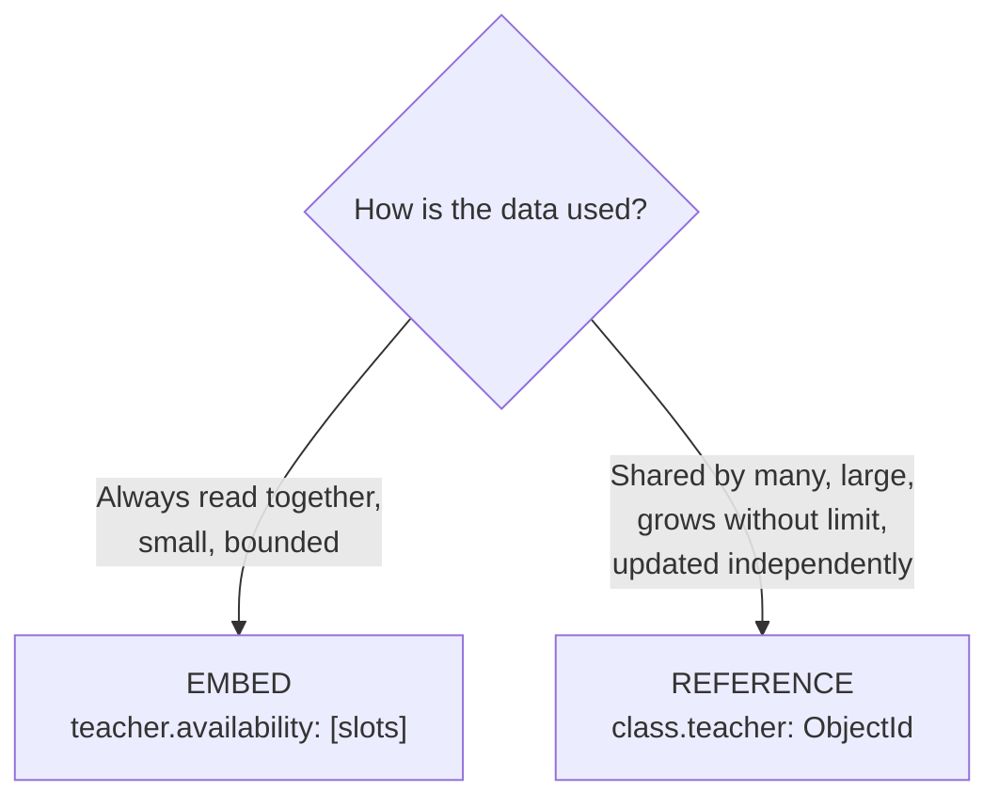
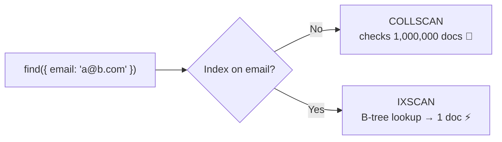
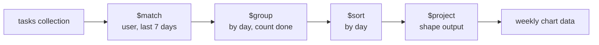
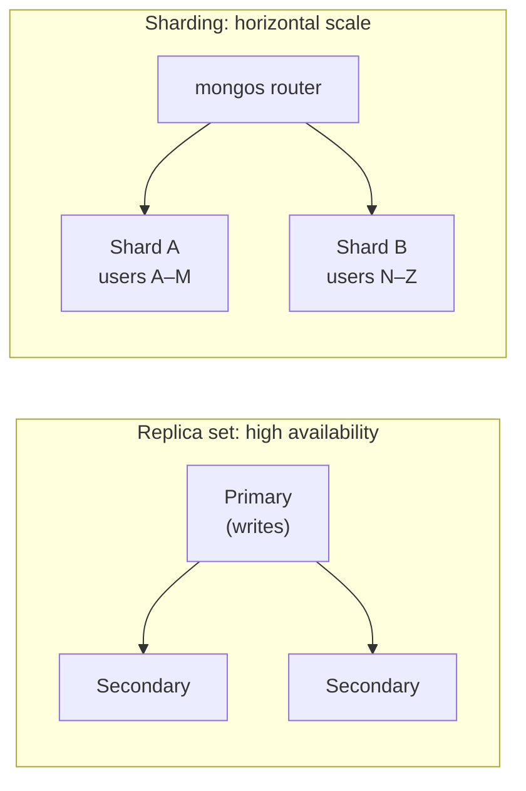

# 4 · MongoDB & Mongoose

MongoDB questions at 3+ years focus on **schema design (embed vs reference), indexes and aggregation**. You optimised aggregation pipelines and indexes at Snowa and in TaskFlow, so use those as your examples.

## Basics

### What is MongoDB, and how is it different from a SQL database? {basic}

MongoDB is a **document database**: data is stored as **JSON-like documents (BSON)** inside **collections**, with a **flexible schema**.

| SQL | MongoDB |
|---|---|
| Database | Database |
| Table | Collection |
| Row | Document |
| Column | Field |
| JOIN | Embedding, `$lookup`, `populate` |
| Fixed schema | Flexible schema (enforce it with Mongoose or validators) |

:::say
"MongoDB stores data as JSON-like documents in collections, so a document can hold nested objects and arrays, like a teacher with their subjects and weekly availability slots in one record. The schema is flexible, which makes development fast, but I still enforce structure with Mongoose schemas. Compared with SQL, relationships are modelled by embedding or referencing instead of joins by default."
:::

### What is BSON and ObjectId? {basic}

- **BSON:** binary JSON. Faster to scan, and supports extra types like `Date`, `ObjectId`, `Decimal128` and binary data.
- **ObjectId:** a 12-byte default `_id`: **timestamp + random value + counter**. It's unique without a central server and roughly sortable by creation time.

:::say
"MongoDB stores documents as BSON, a binary form of JSON with extra types like dates and ObjectIds. Every document has an `_id`, by default an ObjectId, which contains a creation timestamp plus random and counter bytes, so it's unique across machines and roughly ordered by creation time. I can even get the creation date from it with `getTimestamp()`."
:::

### Which CRUD operators do you use most? {basic}

```js
// Read
Task.find({ user: id, status: { $in: ["todo", "doing"] }, due: { $lt: new Date() } })
    .select("title due").sort({ due: 1 }).limit(20);

// Update
Task.updateOne({ _id: id }, { $set: { status: "done" }, $inc: { edits: 1 } });
Teacher.updateOne({ _id: id }, { $addToSet: { subjects: "Maths" } }); // no duplicates
Teacher.updateOne({ _id: id }, { $pull: { subjects: "Physics" } });

// Upsert: update if it exists, else insert
Stat.updateOne({ user: id, day }, { $inc: { done: 1 } }, { upsert: true });
```

:::say
"For queries I use comparison operators like `$in`, `$gt` and `$lt`, plus `$or` and `$and`, with projection to select only the needed fields. For updates, `$set` changes fields, `$inc` increments counters atomically, and `$push`, `$addToSet` and `$pull` manage arrays. Upsert is handy for daily stats: increment if the record exists, otherwise create it in one atomic operation."
:::

## Mongoose

### What is Mongoose, and why use it? {basic}

An **ODM (Object Data Modeling) library** for MongoDB in Node: schemas, validation, middleware, population and a nicer query API.

```js
const userSchema = new Schema({
  name: { type: String, required: true, trim: true },
  email: { type: String, required: true, unique: true, lowercase: true },
  password: { type: String, required: true, select: false },   // never returned by default
  role: { type: String, enum: ["teacher", "school", "admin"], default: "teacher" },
}, { timestamps: true });                                         // createdAt, updatedAt
```

:::say
"Mongoose gives structure to MongoDB in a Node app: I define schemas with types, required fields, enums and defaults, and it validates data before saving. It also adds middleware hooks, virtuals, `populate` for references and automatic timestamps. For example, I mark the password field with `select: false` so it's never returned unless I ask for it explicitly."
:::

### What are Mongoose middleware (hooks)? {mid}

```js
userSchema.pre("save", async function (next) {
  if (!this.isModified("password")) return next();   // only hash when changed
  this.password = await bcrypt.hash(this.password, 12);
  next();
});
```

:::say
"Mongoose middleware runs before or after operations like save, validate or find. The classic use is a `pre('save')` hook that hashes the password, but only if it was modified, so updating a user's name doesn't re-hash it. One catch: `updateOne` and `findOneAndUpdate` don't trigger save hooks, so I'm careful about which method I use."
:::

### What is populate()? How is it different from $lookup? {mid}

```js
const classSchema = new Schema({ teacher: { type: Schema.Types.ObjectId, ref: "Teacher" } });
await Class.find().populate("teacher", "name subjects");
```

| `populate` | `$lookup` |
|---|---|
| Mongoose feature, runs **extra queries** | Database-level join in an aggregation pipeline |
| Easy, readable | Faster for big data; can filter or group after joining |

:::say
"`populate` replaces a referenced ObjectId with the actual document. It's convenient, but under the hood Mongoose runs a second query. `$lookup` is a real join inside the aggregation pipeline, done by the database in one round trip, and I can filter or group on the joined data. For simple screens I use `populate`; for reports and analytics I use `$lookup`."
:::

### What does .lean() do? {mid}

:::say
"By default Mongoose returns full documents with getters, setters and methods like `save`. `.lean()` returns plain JavaScript objects, which is much faster and uses less memory. I use it for read-only API responses and lists, but not when I need to modify and save the document afterwards."
:::

### What are virtuals? {basic}

```js
classSchema.virtual("endsAt").get(function () {
  return new Date(this.startsAt.getTime() + this.durationMin * 60000);
});
```

:::say
"Virtuals are computed properties that aren't stored in the database, like a full name from first and last name, or a class's end time from its start time and duration. They avoid storing duplicate data that could go out of sync."
:::

## Schema design

### Embed vs reference: how do you decide? {mid}



| Embed when… | Reference when… |
|---|---|
| Data is read together | Data is used on its own |
| One-to-few (an address, a few slots) | One-to-many with no bound (all bookings, all messages) |
| The child doesn't change independently | Many documents share it (a teacher used by many classes) |

**Rule of thumb:** *design for how the app reads the data*. And remember the **16 MB** document limit: never embed arrays that grow forever.

:::say
"I decide based on how the data is read. If it's small, bounded and always read together, like a teacher's subjects and weekly availability slots, I embed it, so one query gets everything. If it grows without limit, is shared, or is updated on its own, like bookings or chat messages, I reference it with an ObjectId. A document can't exceed 16 MB, so unbounded arrays must never be embedded."
:::

:::proj
VTMS: subjects, languages and availability fit inside the teacher document (embed). Classes, bookings and feedback are separate collections referencing teacher and school IDs (reference).
:::

### What are some MongoDB schema design patterns? {adv}

| Pattern | Idea | Example |
|---|---|---|
| **Subset** | Embed only the most-used part | Last 5 messages in a chat, the rest in a messages collection |
| **Extended reference** | Copy a few fields of the referenced doc | Store `teacherName` in a class to avoid a lookup |
| **Computed** | Pre-calculate and store results | Daily totals per classroom |
| **Bucket** | Group many small items per document | Sensor readings per device per hour |
| **Outlier** | Handle the rare huge case separately | A teacher with 10,000 bookings |

:::say
"Beyond embed versus reference, I use patterns like extended reference, copying a teacher's name into a class document so lists don't need a join; the computed pattern, storing daily totals instead of recalculating; and the bucket pattern for many small time-series records. The trade-off is always duplication versus read speed, so I duplicate only data that rarely changes."
:::

### How would you design the schema for VTMS? {mid}

```mermaid
erDiagram
  SCHOOL ||--o{ REQUEST : creates
  TEACHER ||--o{ CLASS : teaches
  REQUEST ||--o{ CLASS : "booked as"
  SCHOOL ||--o{ CLASS : hosts
  CLASS ||--o{ FEEDBACK : receives
  TEACHER {
    ObjectId _id
    string name
    string timezone
    array subjects
    array languages
    array availability
    number weeklyCapacity
  }
  CLASS {
    ObjectId teacher
    ObjectId school
    date startsAtUTC
    string status
    boolean reminded1d
    boolean reminded1h
  }
```

:::say
"Teachers embed their subjects, languages, time zone and availability, because matching always reads them together. Requests, classes and feedback are separate collections that reference the teacher and school by ID, because they grow over time and are queried on their own. Each class stores its start time in UTC, its status, and flags for which reminders have been sent."
:::

:::note
**Adapt this** to your real VTMS models before the interview; open your `models/` folder and check the field names.
:::

## Indexes

### What is an index, and why is it important? {basic}

Without an index, MongoDB scans **every document** (a **COLLSCAN**). With an index (a sorted **B-tree**), it jumps straight to matching documents (**IXSCAN**).



:::say
"An index is a sorted data structure, a B-tree, on one or more fields, so MongoDB can find matching documents without scanning the whole collection. It makes reads much faster, but every index costs memory and slows down writes slightly, because it must be updated on each insert. So I index the fields my real queries filter and sort on, and verify with `explain()`."
:::

### Compound indexes and the ESR rule {adv}

A **compound index** covers several fields, and **field order matters**. Follow **ESR**:

1. **E**quality fields first (`user = X`)
2. **S**ort fields next (`sort by createdAt`)
3. **R**ange fields last (`due > date`)

```js
// Query: tasks of one user, status 'done', newest first, in a date range
Task.find({ user: id, status: "done", createdAt: { $gte: from } }).sort({ createdAt: -1 });
// Index following ESR:
taskSchema.index({ user: 1, status: 1, createdAt: -1 });
```

**Prefix rule:** index `{ a, b, c }` also serves queries on `{ a }` and `{ a, b }`, but **not** `{ b }` alone.

:::say
"A compound index covers several fields, and order matters. I follow the ESR rule: equality fields first, then the sort field, then range filters. That lets MongoDB jump to the exact user and status and read results already sorted. A compound index also works for queries on its leading fields, so an index on user, status and date also serves 'all tasks for a user'. That's how I designed TaskFlow's analytics indexes."
:::

:::proj
TaskFlow: compound index on `{ user, createdAt }` for per-user date-range analytics. At Snowa: compound indexes on high-traffic collections behind the dashboard.
:::

### What other index types are there? {mid}

| Index | Use |
|---|---|
| **Unique** | No duplicates (`email`) |
| **TTL** | Auto-delete docs after a time (sessions, OTPs, pairing codes) |
| **Text** | Basic keyword search |
| **Partial** | Index only some docs (`{ status: "active" }`) |
| **Multikey** | Automatic on array fields (`subjects`) |
| **2dsphere** | Geo queries ("schools near me") |

:::say
"Besides normal and compound indexes, I use unique indexes to prevent duplicates like emails, TTL indexes to auto-expire data like OTPs or one-time pairing codes, partial indexes to index only active records, and text indexes for simple search. Indexing an array field automatically creates a multikey index, so a query like 'teachers who teach Maths' is fast."
:::

### How do you check whether a query uses an index? {mid}

```js
await Task.find({ user: id }).sort({ createdAt: -1 }).explain("executionStats");
// Look at: winningPlan.stage (IXSCAN good, COLLSCAN bad),
//          totalDocsExamined vs nReturned (should be close)
```

:::say
"I run `explain('executionStats')` and look at the winning plan: IXSCAN means it used an index, COLLSCAN means a full scan. I also compare `totalDocsExamined` with `nReturned`: if MongoDB examines 50,000 documents to return 20, the index is wrong or missing. Atlas's Performance Advisor also suggests indexes from slow queries."
:::

## Aggregation

### What is the aggregation pipeline? {mid}

A sequence of **stages**; each stage transforms the documents and passes the result to the next.



```js
Task.aggregate([
  { $match: { user: userId, completedAt: { $gte: weekAgo } } },
  { $group: { _id: { $dateToString: { format: "%Y-%m-%d", date: "$completedAt" } }, done: { $sum: 1 } } },
  { $sort: { _id: 1 } },
  { $project: { _id: 0, day: "$_id", done: 1 } },
]);
```

:::say
"The aggregation pipeline processes documents through stages, like a factory line. `$match` filters, `$group` calculates totals, `$sort` orders, `$project` reshapes, and `$lookup` joins other collections. I used it for TaskFlow's weekly productivity chart: match one user's tasks from the last seven days, group by day and count completions. Doing this in the database is far faster than loading every task into Node."
:::

:::tip
"How do you make a pipeline fast?" → "Put `$match` (and `$sort`) first so they can use indexes, reduce fields early with `$project`, and avoid `$lookup` on huge collections without an index on the joined field."
:::

### Which aggregation stages should you know? {mid}

| Stage | Does |
|---|---|
| `$match` | Filter (put it first) |
| `$group` | Totals with `$sum`, `$avg`, `$max`, `$push` |
| `$project` / `$addFields` | Select, rename or compute fields |
| `$sort`, `$limit`, `$skip` | Order and paginate |
| `$lookup` | Join another collection |
| `$unwind` | One document per array element |
| `$facet` | Several pipelines at once (data + total count) |
| `$bucket` | Group into ranges (histograms) |

:::say
"The ones I use most are `$match`, `$group`, `$project`, `$sort`, `$lookup` and `$unwind`. `$unwind` splits an array into separate documents, for example to count classes per subject. `$facet` is handy for paginated results, because one query returns the page of data and the total count together."
:::

### Category breakdown with $unwind (example) {mid}

```js
// Count classes per subject across all teachers
Teacher.aggregate([
  { $unwind: "$subjects" },                                   // one doc per subject
  { $group: { _id: "$subjects", teachers: { $sum: 1 } } },
  { $sort: { teachers: -1 } },
]);
```

:::say
"`$unwind` turns a teacher with three subjects into three documents, one per subject, then `$group` counts them. That gives a breakdown like 'how many volunteer teachers do we have for each subject', which is exactly the sort of report the Trust's admin dashboard needs."
:::

## Transactions, consistency & scaling

### Are MongoDB operations atomic? When do you need transactions? {adv}

- Every operation on a **single document** is **atomic**, including nested fields and arrays.
- **Multi-document transactions** (on replica sets) give ACID across documents.

```js
const session = await mongoose.startSession();
await session.withTransaction(async () => {
  await Teacher.updateOne({ _id: tId, capacityLeft: { $gt: 0 } }, { $inc: { capacityLeft: -1 } }, { session });
  await Class.create([{ teacher: tId, school: sId, startsAtUTC }], { session });
});
```

:::say
"Single-document writes are always atomic, which is a big reason to embed related data. When I must update several documents together, like reducing a teacher's weekly capacity and creating the class booking, I use a multi-document transaction, so either both happen or neither does. Transactions need a replica set, which Atlas provides, and they're slower, so I design the schema to need them rarely."
:::

:::tip
"How do you prevent two schools booking the last slot at the same time?" → "A conditional atomic update: only decrement capacity where `capacityLeft > 0`. If it matched zero documents, the slot is gone."
:::

### What are replica sets and sharding? {mid}



:::say
"A replica set is several copies of the same data: one primary takes writes, and secondaries replicate it. If the primary fails, a secondary is automatically elected, giving high availability. Sharding splits data across machines by a shard key, so you can scale beyond one server. Choosing the shard key is critical: it should spread writes evenly and match common queries. My projects run on Atlas replica sets; I haven't needed sharding at that scale."
:::

### What are write concern and read preference? {adv}

:::say
"Write concern controls how many replicas must confirm a write before it's considered successful; `w: 'majority'` is safer but slightly slower. Read preference controls where reads go: the primary for the latest data, or secondaries to spread load, accepting that data may be slightly behind. For important data like bookings, I use majority writes and primary reads."
:::

### Skip/limit vs cursor (range) pagination? {mid}

```js
// Offset: simple, but slow for deep pages (it still walks over skipped docs)
Task.find(q).sort({ _id: -1 }).skip((page - 1) * 20).limit(20);

// Cursor: fast at any depth
Task.find({ ...q, _id: { $lt: lastSeenId } }).sort({ _id: -1 }).limit(20);
```

:::say
"Skip-and-limit is easy and supports jumping to page numbers, but MongoDB still has to walk past all skipped documents, so page 5,000 is slow. Cursor pagination remembers the last item's ID or date and asks for items after it, which uses the index and stays fast at any depth. That's what infinite scroll and activity feeds should use."
:::

### Common MongoDB performance mistakes? {mid}

:::say
"Missing or wrong indexes; returning whole documents instead of projecting the needed fields; loading data into Node and looping instead of using aggregation; N+1 queries with `populate` inside loops; deep skip-pagination; unbounded arrays that grow toward the 16 MB limit; and not using `.lean()` for read-only queries. I check slow queries with `explain` and fix the biggest ones first."
:::

## Practice problems

These simulate what MongoDB does, so you understand queries deeply.

### Practice 1: Write a mini find() filter {mid}

`matches(doc, query)` supports exact values plus `$gt`, `$lt`, `$in` and `$ne`. All conditions must match (AND).

:::practice
```js starter
function matches(doc, query) {
  // your code here
}
```
```js tests
const task = { status: "done", mins: 45, tag: "work" };
check(matches(task, { status: "done" }), true, "exact match");
check(matches(task, { mins: { $gt: 30 } }), true, "$gt");
check(matches(task, { mins: { $lt: 30 } }), false, "$lt");
check(matches(task, { tag: { $in: ["home", "work"] } }), true, "$in");
check(matches(task, { status: "done", tag: { $ne: "work" } }), false, "AND with $ne");
```
:::

:::hint
Loop over `Object.entries(query)`. If the condition is a plain value, compare with `===`.
:::

:::hint
If it's an object, check each operator: `$gt: v > c.$gt`, `$lt`, `$in: c.$in.includes(v)`, `$ne: v !== c.$ne`. Use `every`.
:::

:::solution
```js
function matches(doc, query) {
  const ops = {
    $gt: (v, x) => v > x, $lt: (v, x) => v < x,
    $in: (v, x) => x.includes(v), $ne: (v, x) => v !== x,
  };
  return Object.entries(query).every(([field, cond]) => {
    const v = doc[field];
    if (cond && typeof cond === "object" && !Array.isArray(cond))
      return Object.entries(cond).every(([op, x]) => ops[op](v, x));
    return v === cond;
  });
}
```
**Explain it:** MongoDB applies the same per-field operator logic. Without an index, it does this for **every** document (COLLSCAN).
:::

### Practice 2: Implement $group with $sum {mid}

`groupSum(docs, key, field)` returns `[{ _id, total }]`, sorted by `total` descending.

:::practice
```js starter
function groupSum(docs, key, field) {
  // your code here
}
```
```js tests
const done = [{ cat: "work", mins: 30 }, { cat: "home", mins: 15 }, { cat: "work", mins: 45 }, { cat: "study", mins: 60 }];
check(groupSum(done, "cat", "mins"), [{ _id: "work", total: 75 }, { _id: "study", total: 60 }, { _id: "home", total: 15 }], "sums per category, sorted");
check(groupSum([], "cat", "mins"), [], "empty input");
```
:::

:::hint
Accumulate totals in a `Map` keyed by `doc[key]`.
:::

:::hint
Convert with `[...map].map(([_id, total]) => ({ _id, total }))`, then sort `b.total - a.total`.
:::

:::solution
```js
function groupSum(docs, key, field) {
  const totals = new Map();
  for (const d of docs) totals.set(d[key], (totals.get(d[key]) || 0) + d[field]);
  return [...totals].map(([_id, total]) => ({ _id, total })).sort((a, b) => b.total - a.total);
}
```
**Explain it:** the equivalent pipeline is `[{ $group: { _id: "$cat", total: { $sum: "$mins" } } }, { $sort: { total: -1 } }]`.
:::

### Practice 3: Implement $lookup (a join) {mid}

`lookup(classes, teachers, "teacherId", "_id", "teacher")` adds a `teacher` array to each class with the matching teacher(s). Make it O(n + m), not O(n × m).

:::practice
```js starter
function lookup(local, foreign, localField, foreignField, as) {
  // your code here
}
```
```js tests
const teachers = [{ _id: "t1", name: "Anita" }, { _id: "t2", name: "Ravi" }];
const classes = [{ id: 1, teacherId: "t1" }, { id: 2, teacherId: "t2" }, { id: 3, teacherId: "t9" }];
const out = lookup(classes, teachers, "teacherId", "_id", "teacher");
check(out[0].teacher, [{ _id: "t1", name: "Anita" }], "joins the right teacher");
check(out[2].teacher, [], "no match gives an empty array");
check(classes[0].teacher, undefined, "original docs not mutated");
```
:::

:::hint
First build an index: a `Map` from `foreignField` value to an array of foreign docs. That's what an index on the joined field does.
:::

:::hint
Then `local.map(d => ({ ...d, [as]: index.get(d[localField]) || [] }))`.
:::

:::solution
```js
function lookup(local, foreign, localField, foreignField, as) {
  const index = new Map();
  for (const f of foreign) {
    const k = f[foreignField];
    if (!index.has(k)) index.set(k, []);
    index.get(k).push(f);
  }
  return local.map((d) => ({ ...d, [as]: index.get(d[localField]) || [] }));
}
```
**Explain it:** building the Map is like having an index on the foreign field. Without it, each lookup scans the whole foreign collection (O(n × m)), which is why `$lookup` needs an index on the joined field.
:::

### Practice 4: Cursor-based pagination {mid}

`nextPage(items, afterId, limit)`: items are sorted by `id` ascending. Return up to `limit` items with `id > afterId` (or from the start if `afterId` is `null`), plus `nextCursor` (the last returned id, or `null` if there are no more).

:::practice
```js starter
function nextPage(items, afterId, limit) {
  // your code here
}
```
```js tests
const rows = [1, 2, 3, 4, 5].map((id) => ({ id }));
check(nextPage(rows, null, 2), { data: [{ id: 1 }, { id: 2 }], nextCursor: 2 }, "first page");
check(nextPage(rows, 2, 2), { data: [{ id: 3 }, { id: 4 }], nextCursor: 4 }, "next page from cursor");
check(nextPage(rows, 4, 2), { data: [{ id: 5 }], nextCursor: null }, "last page has no cursor");
```
:::

:::hint
`filter(r => afterId === null || r.id > afterId)`, then `slice(0, limit)`.
:::

:::hint
To know if there's more, take `limit + 1` items: if you got more than `limit`, there's a next page.
:::

:::solution
```js
function nextPage(items, afterId, limit) {
  const rest = items.filter((r) => afterId === null || r.id > afterId).slice(0, limit + 1);
  const data = rest.slice(0, limit);
  return { data, nextCursor: rest.length > limit ? data[data.length - 1].id : null };
}
```
**Explain it:** in MongoDB this is `find({ _id: { $gt: cursor } }).sort({ _id: 1 }).limit(limit + 1)`. It uses the `_id` index and stays fast on page 1 or page 10,000. The "fetch one extra" trick tells you whether there's a next page without a count query.
:::
