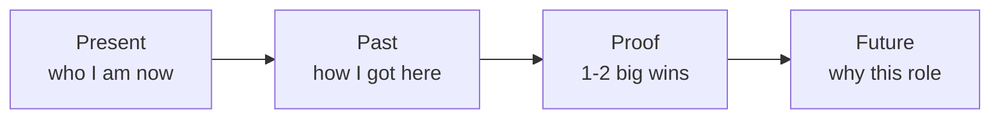
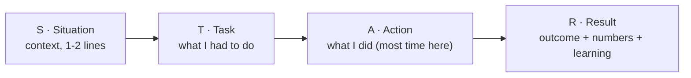

# 10 · HR & behavioural ⭐

Technical rounds get you shortlisted; this round gets you the **offer and the salary**. Practise every answer **out loud**, ideally recording yourself on your phone once.

:::note
**Golden rules:** keep it positive (never criticise a past employer), keep it short (60–90 seconds), keep it consistent with your resume, LinkedIn and Naukri, and always end on **what you can do for them**. Each card: ⚡ **Quick answer** = the core message → 🎤 **Interview answer** = say it point by point.
:::

## Your story

### Tell me about yourself. (60–90 seconds) {basic}

:::quick
**Present → Past → Proof → Future: "Full stack developer, 3+ years MERN → Snowa dashboard → sole developer at the Trust, two products → looking for a product team."**
**Why it matters:** it's the first question in almost every interview and sets the tone.
:::

**📖 Explanation**

:::say
- **Present:** I'm **Vinay**, a **full stack developer** with **over three years** of experience in the **MERN stack**, based in **Hyderabad**.
- **Past:** I started at **Snowa Technologies**, where I built a **complete full-stack dashboard**: more than **20 React pages** and over **15 Node and Express APIs**, with **MongoDB** data modelling and query optimisation.
- **Proof:** for the last year and a half I've been the **sole developer at Swashodhan Trust**, building software for rural education. I **conceived and built two products**:
- **VTMS** matches volunteer teachers worldwide with **590 rural classrooms**, with a matching engine, time-zone handling and reminders.
- **Digital Classroom Monitoring** tracks whether those classrooms are actually used; I took it from **idea to pilot in four weeks**, with **PostgreSQL** and **over 80 automated tests**.
- **Future:** alongside that I'm doing an **online MCA**. Now I'm looking for a **full-stack role in a product-focused team**, and that's why this role interested me.
:::

:::warn
- Don't recite your resume line by line, and don't start with your school or family background.
- Change the last point for each company (mention their product or domain).
:::

### Tell me about yourself: Kochi startup version {basic}

:::quick
**Same story, but lead with ownership, Node + PostgreSQL and building with AI, and end with "I want to build a product from the early stage with a founding team."**
**Why it matters:** founders listen for "can this person own things without hand-holding?"
:::

:::say
- I'm **Vinay**, a **full stack developer** with **over three years** of experience: **React, Node.js**, and both **MongoDB and PostgreSQL**.
- For the last year and a half I've worked like a **one-person product team** at Swashodhan Trust: I find the problem, **design the solution, build it, test it and ship it**.
- My latest product, **Digital Classroom Monitoring**, is a **Node.js and PostgreSQL** system for **590 classrooms**. I took it from **idea to pilot in four weeks**, using **AI tools** to write code while I owned the **requirements, design, testing and approvals**, with **80+ automated tests**.
- Before that I built **VTMS**, a React and Node platform with **matching, scheduling and reminders**, and a full-stack dashboard at **Snowa Technologies**.
- I'm excited about this role because I want to **build a real product from the early stage** with a **founding team**, where I can **own features end to end** and my ideas matter.
:::

### Walk me through your resume / career journey. {basic}

:::quick
**B.Sc. (Maths) → discovered programming → Snowa (team, dashboards, APIs) → Swashodhan (sole developer, own products) → now: more ownership and a bigger product.**
**Why it matters:** shows a clear direction, with each step adding ownership.
:::

:::say
- I did a **B.Sc. in Maths, Physics and Chemistry**, and discovered programming by **building web projects**, which led me to the **MERN stack**.
- My first role at **Snowa** taught me professional full-stack development **in a team**: dashboards, APIs and database work.
- At **Swashodhan** I moved into **owning products end to end** as the only developer, from talking to the people with the problem to deployment.
- **Each step gave me more ownership**, and now I want to bring that into a **product team**.
:::

## The tricky questions

### Why are you looking for a change? / Why leave an NGO? {basic}

:::quick
**Growth: you've learned to own products alone; now you want peers to learn from, code reviews, and a bigger product. Leaving on good terms.**
**Why it matters:** never mention money as the main reason, never criticise the NGO.
:::

:::say
- I've learned a lot at the Trust, especially **owning products end to end** and building for **real users**.
- But as the **only developer**, I don't have **senior engineers to learn from** or **code reviews** from peers, and the **scale is limited**.
- I want to grow in a **strong team**, work on a product with **more users**, and learn best practices from experienced people.
- I'm **proud of what I built** there, and I'm **leaving on good terms**.
:::

:::warn
Never mention salary as the main reason, and never complain about the NGO.
:::

### You have a B.Sc., not a B.Tech in Computer Science. Why should we consider you? {mid}

:::quick
**Maths gave you strong logic; three years of shipped software prove the rest; the MCA strengthens the theory.**
**Why it matters:** answer calmly and point to real work, not apologies.
:::

:::say
- My degree is in **Maths, Physics and Chemistry**; the maths gave me strong **logical thinking**, which helps with problem solving and algorithms.
- Since then I've **proven myself through three years of building real software**: production dashboards at Snowa and **two products in pilot** at the Trust.
- To strengthen the theory, I'm pursuing an **MCA**.
- I'd be happy to **show you my code on GitHub**.
:::

### You're doing an MCA. Will it affect your work? {basic}

:::quick
**No: it's an online MCA from Andhra University for working professionals; you study evenings and weekends, and it strengthens your fundamentals.**
**Why it matters:** removes a worry about your availability, especially for a Monday–Saturday role.
:::

:::say
- **No.** It's an **online MCA from Andhra University**, designed for **working professionals**.
- I study in the **evenings and on weekends**, and I've been managing it alongside a full-time job.
- It actually **helps my work**: I'm strengthening fundamentals like **data structures, databases and operating systems**.
:::

:::note
**Monday to Saturday (Kochi role):** if exams fall on a working Saturday, say you'd **plan leave in advance**. Check your exam schedule before the interview so you can answer confidently.
:::

### What is your current and expected CTC? {mid}

:::quick
**Give your real current CTC, then an expected range justified by your value, not by your current salary.**
**Why it matters:** a clear, honest number with a reason sounds confident; hesitation loses money.
:::

**Strategy:**
1. **Research the market** for the role, city and your years of experience.
2. **Decide your range and your minimum** before the call.
3. **Never inflate your current CTC.** They may ask for payslips.

:::say
- My **current CTC is [X] lakhs** per annum.
- Based on the role and my **three-plus years** of full-stack work, including **two products I built end to end**, I'm looking for **[range]**.
- I'm flexible for the **right role and learning opportunity**.
:::

### What is your notice period? {basic}

:::quick
**Give one honest answer and use it everywhere (resume, Naukri, LinkedIn, every call).**
**Why it matters:** a mismatch between profiles and interviews raises doubts.
:::

:::say
- My notice period is **[X]**.
- I'll make sure I **hand over properly**, with documentation for the systems I built.
:::

### Are you comfortable with Kochi, hybrid and Monday–Saturday? {basic}

:::quick
**The role is Remote / Hybrid (Kochi), Monday to Saturday, 9 am to 5 pm. Decide your honest answer before the call.**
**Why it matters:** this is often a yes/no filter in the first HR call.
:::

:::say
- **Yes**, I'm comfortable with **remote or hybrid**, and I can **travel to Kochi** when the team needs me *(or: relocate to Kochi, if that's true)*.
- **Monday to Saturday, 9 to 5** works for me.
- I've worked **independently and remotely** with the Trust's teams, so I'm used to clear written updates and self-managed work.
:::

:::warn
**Only say what's true.** Decide before the call: *Will you relocate to Kochi, or only travel sometimes? Is Saturday work OK with your MCA?* Then answer the same way every time.
:::

### Why should we hire you? {basic}

:::quick
**Three reasons: you've shipped real products end to end, you start from the problem, and you're fast and careful (pilot in 4 weeks, 80+ tests).**
**Why it matters:** your closing pitch: short, specific and confident.
:::

:::say
- **First**, I'm a full-stack developer who's **shipped real products end to end**: React, Node, MongoDB and PostgreSQL, deployed and tested.
- **Second**, I **start from the problem**: I've worked directly with users to decide what to build, so I don't just write code to a ticket.
- **Third**, I'm **fast and careful at the same time**: I took a product from **idea to pilot in four weeks** with **over 80 automated tests**.
- I'd bring that **ownership and speed** to your team.
:::

### Why do you want to join our company? {basic}

:::quick
**One specific thing about their product or mission + how your experience fits + what you want to learn.**
**Why it matters:** generic answers ("good company, good growth") show you didn't prepare.
:::

**Do 10 minutes of research** before each interview: their product, customers, tech stack and recent news.

:::say
- I looked at **[product / what they do]**, and I like that **[something specific: their scale, domain, tech stack]**.
- My experience building **[related thing: dashboards, matching and booking, data-heavy apps]** fits well with what your team is doing.
- And I'd get to **grow** in a team with **strong engineering practices**.
:::

:::proj
**Kochi version:** "A marketplace for **therapeutic wellness retreats** is a real product solving a real problem, and building it from the **early stage** is exactly what I want. I've built **matching, scheduling and reminders** in VTMS and **reliable, exactly-once data** in Digital Classroom, which map closely to **listings, bookings and payments**. And you build with **AI tools as a core part of the workflow**, which is how I already work."
:::

### Where do you see yourself in 5 years? {basic}

:::quick
**A senior full-stack engineer who designs systems and mentors others, growing into technical leadership, here.**
**Why it matters:** shows ambition that stays with the company.
:::

:::say
- I see myself as a **senior full-stack engineer** who **designs systems**, not just features.
- I'd like to **mentor newer developers** and grow into **technical leadership** on a product.
- I'd love that growth to happen **here**, especially growing **with the product** from the early stage.
:::

### What are your strengths? {basic}

:::quick
**Ownership (problem → tested, deployed product) and explaining technical things simply to non-technical people.**
**Why it matters:** both are exactly what a founding team needs.
:::

:::say
- My biggest strength is **ownership**: I like taking a problem from **"what should we build?"** all the way to a **tested, deployed product**.
- Example: with **Digital Classroom Monitoring** I **defined the rules, designed the system, tested every release on a real device**, and got it to a pilot in **four weeks**.
- I'm also good at **explaining technical things simply** to non-technical people, which I do with the Trust's programme staff **every week**.
:::

### What is your biggest weakness? {basic}

:::quick
**As the only developer, you're used to deciding alone and sometimes start building before getting enough review; you now write a short design note first and share it.**
**Why it matters:** a real weakness with a real fix sounds mature.
:::

:::say
- Because I've been the **only developer** at the Trust, I'm used to **making decisions alone**, and sometimes I **start building before getting enough review**.
- I've been working on that by **writing a short design note** before big features, like the one for record storage in Digital Classroom, and **sharing it for feedback first**.
- I'm looking forward to working with **code reviews in a team**.
:::

:::warn
Avoid fake weaknesses like "I'm a perfectionist" or "I work too hard". Interviewers hear them every day.
:::

## Behavioural questions (STAR method)

### What is the STAR method? {basic}

:::quick
**Situation → Task → Action → Result, about 1.5–2 minutes, with 60% of the time on Action, and say "I".**
**Why it matters:** every "tell me about a time…" question uses this shape.
:::

**📖 Explanation**

:::say
- **Situation**: the context, in one or two lines.
- **Task**: what I had to do.
- **Action**: what **I** did, step by step; this is where most of the time goes.
- **Result**: the outcome, with **numbers**, and what I **learned**.
:::

### Tell me about a challenging problem you solved. {mid}

:::quick
**Unreliable rural internet → no record may be lost or counted twice → unique key + `ON CONFLICT DO NOTHING` → safe retries, totals never double.**
**Why it matters:** your strongest technical story, told in STAR form.
:::

:::say
- **Situation:** classroom boxes in rural schools upload data over **unreliable internet**.
- **Task:** make sure **no usage record was ever lost or counted twice**.
- **Action:** I gave every record a **unique ID** from the device and a sequence number, put a **unique constraint** on it in PostgreSQL, and used **"insert on conflict do nothing"**, so retries are safe. The box only deletes records **after the server confirms** them.
- **Result:** resending a batch **never doubles totals**, and we can **retry freely** after network drops. I learned to put **correctness rules in the database**, not just in code.
:::

### Tell me about a time you made an important decision with incomplete information. {mid}

:::quick
**Defining "used" for Digital Classroom: learning apps only, more than 10 minutes, and missing data shown as "awaiting data", never zero.**
**Why it matters:** shows product judgement and stakeholder communication.
:::

:::say
- **Situation:** for Digital Classroom we had to define what counts as a classroom being **"used"**.
- **Task:** set a rule that was **fair to schools** and **useful to the Trust**.
- **Action:** I proposed that only **approved learning apps** count, that **more than 10 minutes** a day marks the classroom as used, and most importantly that **missing data shows as "awaiting data"**, never zero. I **explained the trade-offs** to the programme team and **got their agreement**.
- **Result:** reports are **fair**, schools aren't **blamed for internet problems**, and the Trust **trusts the numbers**.
:::

### Tell me about a time you worked under a tight deadline. {mid}

:::quick
**Idea to pilot in four weeks as the only developer: split into three parts, shipped the smallest version first, tested every release on a real box.**
**Why it matters:** startups ship fast; this proves you can without cutting corners.
:::

:::say
- **Situation:** the Trust needed a working way to **monitor classroom usage quickly**.
- **Task:** go from **idea to pilot in about four weeks**, as the **only developer**.
- **Action:** I split it into **three parts** (device app, server and dashboard), **shipped a minimal recording app first** and tested it on a real box, then added uploads, the dashboard and reports. I used **AI coding tools for speed** but **tested every release myself** on a real device, and fixed field feedback the **same day**.
- **Result:** an **online pilot in four weeks**, with **12 tested releases** and **over 80 automated tests**.
:::

### Tell me about a disagreement or conflict. How did you handle it? {mid}

:::quick
**A request to count "TV on" as "used" → you showed what the data can and can't prove → agreed on counting learning-app time only, with an honest limits section.**
**Why it matters:** shows you disagree with evidence, not ego.
:::

:::say
- **Situation:** a request came in to count **any time the classroom TV was on** as "used".
- **Task:** I believed that would make the reports **misleading**.
- **Action:** instead of just saying no, I **showed what the data could and couldn't prove**: the box can't tell whether the TV is on or whether children are watching. I proposed counting **only learning-app time** and **clearly listing what the system doesn't measure**.
- **Result:** we **agreed on the honest version**, and a **"what this data does not prove"** section became part of the project overview. I learned that **showing evidence works better than arguing**.
:::

:::note
**Adapt this** to a real disagreement you had, at Snowa or the Trust. Keep it professional, focused on the problem rather than the person, and ending in agreement.
:::

### Tell me about a mistake or failure. {mid}

:::quick
**A real, small mistake → you took responsibility → fixed it → added a test or checklist step so it can't happen again.**
**Why it matters:** honesty plus learning is the whole point; don't pick a disaster.
:::

:::say
- **Situation:** [**early in a project, I …** e.g. pushed a change without testing it on a real device / underestimated a feature].
- **Task:** I had to **fix the impact quickly**.
- **Action:** I [**rolled back / fixed it and told the team openly**], then added [**a test / a checklist step**] so it couldn't happen again.
- **Result:** [**outcome**]. Since then I always [**test on a real device before release / write a test for every bug I fix**].
:::

:::note
**Fill this in with a real, small mistake.** Interviewers want honesty plus learning, not a disaster story. Taking responsibility is the point.
:::

## Other common questions

### How do you use AI tools in your work? {basic}

:::quick
**AI drafts code, tests and options; you review every change like a junior developer's pull request, test it on real data, and own the result.**
**Why it matters:** the Kochi role says AI tools are "a core part of your workflow".
:::

:::say
- I use **Claude Code and ChatGPT or Codex** as productivity tools: drafting **code and tests**, exploring **options** and writing **documentation**.
- I treat their output like a **junior developer's pull request**: I **review every change**, understand it, **test it on real data**, and **own the result**.
- I set **rules** too, like never storing secrets in plain text and never touching the live database with sample data.
- It makes me **faster without lowering quality**: Digital Classroom went from idea to pilot in **four weeks**.
:::

### How do you work independently? (Kochi: "ability to work independently") {basic}

:::quick
**Clarify the goal, break it into small shippable steps, decide what you can, ask early when blocked, and send short written updates.**
**Why it matters:** it's one of their must-haves, listed next to TypeScript.
:::

:::say
- First I **clarify the goal** and what "done" means, and I write it down.
- I **break the work into small steps** that I can **ship and test** one at a time.
- I make the decisions I can, and I **ask early** when something is truly unclear, with **options and my recommendation**, not just a question.
- I send **short written updates** so nobody has to chase me.
- That's how I've worked as the **sole developer** at the Trust for the last year and a half.
:::

### How do you keep your skills up to date? {basic}

:::quick
**You learn by building (Digital Classroom taught you PostgreSQL and Android), plus the MCA, official docs and regular DSA practice.**
**Why it matters:** shows you'll pick up their stack quickly.
:::

:::say
- I **learn by building**: each project pushes me into something new; Digital Classroom taught me **PostgreSQL and Android**.
- I'm doing an **MCA** for stronger fundamentals.
- I follow **official docs and release notes** for React, Node and TypeScript.
- And I practise **DSA** regularly.
:::

### Are you open to relocation, hybrid or office work? {basic}

:::quick
**Based in Hyderabad; open to on-site, hybrid or remote, and to relocating for the right role (only if true).**
**Why it matters:** must match your LinkedIn "Open to Work" settings.
:::

:::say
- **Yes.** I'm based in **Hyderabad**, and I'm open to **on-site, hybrid or remote** work.
- I'm open to **relocating** for the right role.
:::

:::note
Only say this if it's true. For the Kochi role, use the Kochi card above.
:::

### Do you have any other offers? {basic}

:::quick
**"I'm in conversation with a few companies, but this role interests me most because…"; never invent an offer.**
**Why it matters:** honest leverage without bluffing.
:::

:::say
- I'm **in conversation with a few companies**.
- But this role is one I'm **especially interested in** because of **[reason]**.
:::

:::tip
If you **do** have an offer, it's fine to mention it honestly. It can help negotiation, but never invent one.
:::

## Questions to ask them at the end

### What should I ask the interviewer? {basic}

:::quick
**Always ask 2–3 questions about the work, the team and success in the first 90 days. Never say "no questions".**
**Why it matters:** good questions show you think like an owner.
:::

- "What does a typical week look like for someone in this role?"
- "What would you expect me to achieve in the first 3 months?"
- "What's your tech stack, and how do you do code reviews and deployments?"
- "What's the biggest technical challenge the team is facing right now?"
- "How is the team structured, and who would I work with most?"
- *(HR round)* "What are the next steps, and when can I expect to hear back?"

:::proj
**Kochi founders:** "What's the biggest problem the product must solve in the next 6 months?" · "Is there an existing codebase, or would I build from the start?" · "How do you use AI tools in the team today?" · "How does Remote / Hybrid work in practice?"
:::

:::warn
Don't ask about leave, salary or work-from-home in the technical rounds; save those for HR. Never say "No, I don't have any questions."
:::

## Before every interview: checklist

### 30-minute pre-interview checklist {basic}

:::quick
**Re-read the job description, research the company, say "Tell me about yourself" twice, revise two project stories, fix your numbers, prepare 3 questions, test your setup.**
**Why it matters:** 30 minutes of preparation changes how confident you sound.
:::

- ☐ Read the **job description** again and list the 3 skills they care about most (Kochi: **TypeScript · Node · React · PostgreSQL · working independently**)
- ☐ Research the company: product, users, tech, recent news
- ☐ Say **"Tell me about yourself"** out loud twice, tailored to this company
- ☐ Revise the **Digital Classroom** and **VTMS** walkthroughs (Doc 9)
- ☐ Have numbers ready: **590 · 64 · 100-point · 69 tests · 4 weeks · 12 releases · 80+ tests**
- ☐ Know your **CTC numbers** and **notice period**, and say them the same way every time
- ☐ Prepare **3 questions** to ask them
- ☐ Video calls: test camera and mic, use a quiet room and plain background, keep water and a notebook nearby
- ☐ Keep your resume, portfolio and GitHub open in tabs
